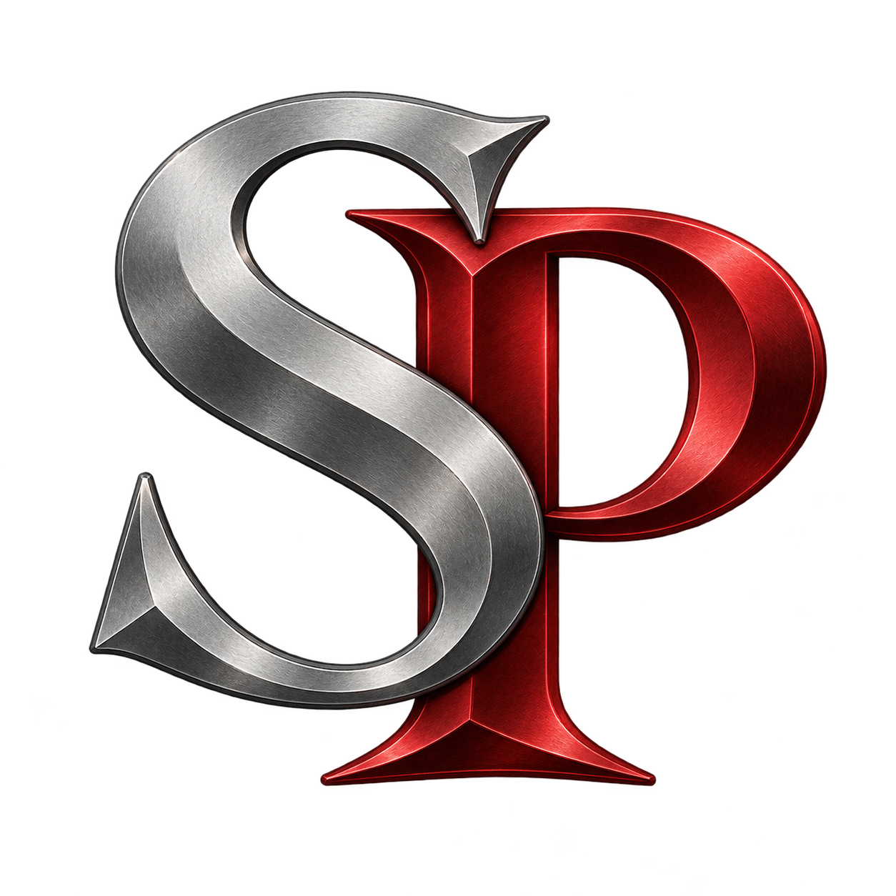

<p align="center">
  <br>
  
</p>

# SpartanPort

<div align="center">
  <a href="https://trendshift.io/repositories/299469?utm_source=trendshift-badge&amp;utm_medium=badge&amp;utm_campaign=badge-trendshift-299469" target="_blank" rel="noopener noreferrer"></a>
</div>

**English** | [Português (Brasil)](README.pt-BR.md) | [Español](README.es.md) | [Bahasa Indonesia](README.id.md)

**SpartanPort** is an unofficial PC port of **God of War III Remastered** (PlayStation 4) for Windows 10/11,
Linux (experimental AppImage) and Macs with Apple Silicon ([experimental](#macos-apple-silicon-experimental)).

> **No game files are included.** You need a dump from your own PS4 (tested: CUSA01623 and
> CUSA01715, versions 01.00 and 01.02).
> This project is not affiliated with or endorsed by Sony Interactive Entertainment or Santa Monica Studio.
> God of War is a trademark of Sony Interactive Entertainment.

> **Formerly gow3_pc.** Updating from 2.5.0 through the launcher keeps your saves and settings:
> on the first start, the game settings (`gow3.ini`), the launcher settings and, on Linux, the data
> folder (`~/.local/share/gow3`) are copied to their new names. The old files stay where they were,
> and existing shortcuts keep working. On Linux, the AppImage is now `spartanport-x86_64.AppImage`:
> update Steam launch options that use the old file name.

## Contents

- [SpartanPort](#spartanport)
  - [Contents](#contents)
  - [Download and play](#download-and-play)
  - [Linux (AppImage, experimental)](#linux-appimage-experimental)
  - [macOS (Apple Silicon, experimental)](#macos-apple-silicon-experimental)
  - [What works](#what-works)
  - [Feature availability](#feature-availability)
  - [Settings](#settings)
  - [Keyboard controls](#keyboard-controls)
  - [Importing shadPS4 saves](#importing-shadps4-saves)
  - [Third-party overlays (Windows)](#third-party-overlays-windows)
  - [Overlays on a Mac](#overlays-on-a-mac)
  - [Troubleshooting](#troubleshooting)
  - [Performance and compatibility](#performance-and-compatibility)
  - [Building from source](#building-from-source)
    - [Windows](#windows)
    - [Linux (Ubuntu 24.04)](#linux-ubuntu-2404)
    - [macOS](#macos)
  - [Tests](#tests)
    - [Python](#python)
    - [Windows C++ tests (MSYS2 CLANG64)](#windows-c-tests-msys2-clang64)
    - [Linux C/C++ tests](#linux-cc-tests)
    - [macOS C/C++ tests](#macos-cc-tests)
    - [Checks using a prepared game](#checks-using-a-prepared-game)
  - [How it works](#how-it-works)
  - [Credits](#credits)
  - [License](#license)

## Download and play

- Windows 10 (1903 or newer) or Windows 11, 64-bit.
- A 64-bit processor with AVX: Intel Sandy Bridge (2011) or newer, AMD FX or newer. On CPUs without
  MOVBE, BMI1 or LZCNT (Sandy/Ivy Bridge, AMD FX) the loader rewrites the game's instructions that
  use them to emulated stubs and logs an `ISA:` line; performance on those CPUs has not been
  measured yet. Older CPUs stop at start with a `STOP: this CPU lacks` line in the log.
- A graphics card with Vulkan 1.3 and a current driver.
- Your copy of the game (the folder with `eboot.bin`, `sce_module` and `sce_sys`). Tested:
  CUSA01623 and CUSA01715, versions 01.00 and 01.02.

**Steps**

1. Download `spartanport-windows.zip` from the
   [Releases page](https://github.com/FelipePrado0/SpartanPort/releases/latest).
2. Extract it to a folder of your choice, for example `C:\Games\spartanport-windows`. Do not run it from
   inside the zip.
3. Open **`SpartanPort.exe`**. If Windows shows "Windows protected your PC", click
   **More info**, then **Run anyway**: the program is not digitally signed.
4. Click **Choose the game folder**. It takes you to the **Game** page. Next to **Game folder**,
   click **Browse…** and select the folder with `eboot.bin`.
5. Back on **Home**, the cover art and "CUSA01623 · version 01.02" appear. Adjust **Quick
   settings** if you like: display mode, frame rate limit, render resolution and engine frame
   rate.
6. Click **Save** to keep pending changes, then **PLAY**. The first start prepares the game image;
   shader compilation can also affect startup and performance on later launches.

Patches and fixes are included and applied automatically: texture fix, skip videos with X and
120 FPS are on by default. Change the resolution and frame rate on **Home** or **Performance**.
The startup black-screen fix is always requested, even with an older saved patch selection;
patches apply only where their signatures match. A resolution patch replaces the texture fix.

**While playing**

- **Insert** on the keyboard, or **R3 + L2** on the controller, opens the port's menu: cheats,
  multipliers, image, performance and the performance overlay.
- Saved shaders load in the background. A small "Loading shader cache" note in the corner shows
  the progress.

**Next time**

- **`Play SpartanPort.exe`** starts the game straight away with your saved settings. You can
  make a desktop shortcut to it, or add it to Steam with **Add a Non-Steam Game**.
- Your saves, shader cache and log are in the `user` folder next to `SpartanPort.exe`. Keep
  that folder when you update.
- **Advanced → Check for updates** downloads and installs a new version. Your saves and settings
  are kept.

## Linux (AppImage, experimental)

The Linux build runs the same native runtime and the same launcher. It was tested on Arch Linux
with a Radeon RX 7800 XT (RADV) in a Wayland session.

**You need:** x86-64 Linux with glibc 2.39 or newer, an AVX-capable CPU, a Vulkan 1.3 driver
and your own game dump. Launcher startup is checked on Ubuntu 24.04, Debian 13, Fedora 42,
Arch and openSUSE Tumbleweed; this does not establish gameplay compatibility on every GPU.

**Download and run**

1. Download `spartanport-x86_64.AppImage` from the
   [Releases page](https://github.com/FelipePrado0/SpartanPort/releases/latest).
2. In its folder, run:
   ```bash
   chmod +x spartanport-x86_64.AppImage
   ./spartanport-x86_64.AppImage
   ```
3. Choose your game folder, save the settings and press **PLAY**.

If an older download reports `GLIBC_2.44 not found`, download the rebuilt AppImage again.
The Windows updater is not available on Linux; download a newer AppImage to update.
Steam Deck/RADV rendering corruption is a known issue in the published 2.2.0 AppImage.

- **Files:** saves, settings, shader cache and the log are in `~/.local/share/spartanport`; the launcher's
  own settings in `~/.config/spartanport-launcher`.
- **Update folder:** if the update was dumped apart from the game, choose it under **Game → Update
  folder**. It is laid over the game folder without changing either.
- **Advanced → Linux:** window system (automatic, Wayland or X11), GameMode and MangoHud. Only the
  tools installed on the system can be turned on.
- **Steam:** **Advanced → Add to Steam** adds "SpartanPort" as a non-Steam game, with
  the icon, the vertical and horizontal capsules, the library background and the logo made from the
  dump's pictures. Close Steam first (it rewrites its shortcuts when it exits). The button is also in
  the Windows and Mac launchers (not tested with Steam there yet).
- **Steam Deck / SteamOS (Gaming Mode):** if Steam tries to launch the AppImage with Proton, open
  the shortcut's **Properties → Compatibility** and select **Steam Linux Runtime** instead of Proton.
  The AppImage is a native Linux application. If it fails to launch using **Steam Linux Runtime**, open the shortcut’s **Properties → Compatibility** and select **Default** to use the host libraries instead.
- **Menu entry:** the AppImage writes `~/.local/share/applications/spartanport.desktop` when it starts, so
  the launcher and the game window show their icon in the dock; **Advanced → Linux** turns it off and
  removes the entry. When another tool (Gear Lever, AppImageLauncher…) already made an entry that
  starts the same file, it makes none and removes its own, so there are no duplicates.

## macOS (Apple Silicon, experimental)

The macOS build runs the same native runtime under Rosetta 2, with the graphics on Mesa's
KosmicKrisp Vulkan driver (Vulkan on Metal). It was tested on an M4 Pro (macOS 27) through the
opening and the first fights; it has not been played through yet. Details and what differs from
Linux: [packaging/macos/README.md](packaging/macos/README.md).

**You need:** a Mac with Apple Silicon (M1 or newer), macOS 26 (Tahoe) or newer, Rosetta 2 and
your own game dump. Intel Macs are not supported. When Rosetta 2 is missing the **Log** page says
so; install it in Terminal with `softwareupdate --install-rosetta --agree-to-license`. Python, the
libraries and the Vulkan driver are inside the application.

**Download and play**

1. Download `spartanport-macos.dmg` from the
   [macOS releases page](https://github.com/nizwar/gow3_macos/releases/latest).
2. Open it and drag **SpartanPort** onto **Applications**.
3. The application is not signed with an Apple Developer ID, so macOS blocks it. Allow it once in
   Terminal:
   ```bash
   xattr -dr com.apple.quarantine "/Applications/SpartanPort.app"
   ```
4. Open **SpartanPort** and choose your game folder (an update dumped apart from the game goes
   in **Update folder**), click **Save**, then **PLAY**. The first start takes longer: Rosetta
   translates the game's code and the shaders are compiled.

For more FPS on a 1080p screen: **Performance → Render resolution → 720p** (or 480p) and
**Graphics → Upscaling → Upscale to the window** with **Upscaler → MetalFX (Apple)**. Every render
resolution smaller than the window is enlarged, and the performance overlay then says
"MetalFX 720p->1080p". On an M4 Pro that is about 52 FPS in the first fight, against 32 at native
1080p. At 480p bright areas blow out (a known bug of the game at that resolution).

- **Menu key:** **`** (the key left of 1) opens the port's menu, as a Mac keyboard has no Insert
  key; R3 + L2 works as on the other systems.
- **Keyboard and mouse:** R2 and Dodge are on the mouse's side buttons by default, which a trackpad
  or a Magic Mouse does not have: give them keys on the launcher's **Controls** page.
- **Files:** saves, settings, the shader cache and the log are in
  `~/Library/Application Support/spartanport` (**Advanced → Port folder** opens it), the launcher's
  own settings too. Start the application from Applications, Launchpad or the Dock.
- **From 2.4.0 (God of War III.app):** the first start of SpartanPort copies the saves and settings
  from `~/Library/Application Support/gow3` and `~/.config/gow3-launcher`, leaving them as they
  are (the shader cache is built again while you play). The old application can then be deleted.
- **Updates:** **Advanced → Check for updates** asks this repository's releases (tags
  `macos-v<version>` with `spartanport-macos.dmg`) and downloads the newer disk image: drag the new
  application over the old one. Saves and settings are kept.
- **Steam:** **Advanced → Add to Steam**, as on Linux (`~/Library/Application Support/Steam`), with
  Steam closed; Steam then starts the game without the launcher.
- **Advanced → macOS → Metal performance HUD:** Apple's overlay with frame rate, frame times and
  memory on the game window, the Mac's counterpart of MangoHud.
- **Graphics → Upscaling → Fewer GPU waits (experimental):** less CPU load where readbacks stop the
  draws; on the M4 Pro it does not raise the FPS, which the GPU side limits.
- **Performance overlay:** GPU use is the whole GPU's (macOS has no counter per process) and RAM is
  Activity Monitor's figure.
- **Performance → GPU data** has no graphics card or stream buffer memory choice: a Mac has one GPU
  that shares the system's memory.
- **Without the launcher's window:**
  `"/Applications/SpartanPort.app/Contents/MacOS/SpartanPort" --play` starts the game with the
  saved settings.

## What works

- Opening, menus, video cutscenes (H.264) and gameplay.
- Audio: music, voices and effects (ATRAC9 and MP3).
- Controller (DualSense, Xbox and others, through SDL3) and keyboard at the same time, both
  remappable.
- **In-game button icons** (opt-in, off by default): the PlayStation button icons in the game can
  show your controller's, Xbox or Nintendo ones, or the keyboard keys you play with (Game page, Controls).
- Saving and loading: the save list is shown on screen, as on the PS4. Autosave works too. The
  launcher backs the saves up before every start.
- Patches: render resolution of 480p, 720p, 900p, 1440p, 1800p or 4K, corrupted texture fix and skip
  videos with the X button (community); engine frame rate of 120 FPS (kvicken), 100 FPS (for 100 Hz displays),
  144 FPS (for 144 Hz displays) or 240 FPS (adapted by Felipe Prado).
- **Ultrawide (beta):** 21:9, 32:9 and 16:10 render resolutions (3440x1440 tested) with a wider field of view
  instead of a zoomed-in picture, built in: choose one in **Render resolution**, where every size shows its exact
  resolution and aspect ratio. Cutscenes keep their 16:9 borders (see [docs/ultrawide.md](docs/ultrawide.md)).
  Mods can also carry game patches; the [Ultrawide mod](extras/mods/Ultrawide) is the same sizes for older versions.
  **How to install a mod:** put its `.zip` (do not unzip it) in the `mods` folder next to `SpartanPort.exe`;
  the game unpacks it by itself. The Ultrawide mod and a one-click installer for 2.2.0 are explained in
  [extras/mods/Ultrawide](extras/mods/Ultrawide/README.md).
- **Background shader compilation:** saved pipelines load and compile in the background while
  you play. Stutters, missing effects during compilation and temporary FPS drops can still occur;
  startup time depends on the cache, graphics driver and CPU.
- **Launcher** in the game's colors, with selectable languages and English fallback: five pages
  (**Home, Graphics, Performance, Game, Advanced**) and a **Save** button for pending changes;
  quick settings on the home page, graphics,
  performance, game folder and save backups, patches, mods (order, presets and conflicts),
  controls with PlayStation or Xbox button icons, updates and diagnostics.
- **In-game menu** (Insert on the keyboard, ` on a Mac, R3+L2 on the controller), with four tabs:
  - **Game:** cheats (infinite health, magic, item meter, Rage of Sparta, max red orbs,
    automatic QTE: button and stick-rotation prompts answer themselves);
    multipliers from 0.1x to 100x for red, green (health), blue (magic) and gold (Rage of
    Sparta) orbs and for damage dealt and taken; an enemy health bar.
  - **Image:** display mode (windowed, borderless, fullscreen), VSync and RCAS sharpening; on a
    Mac also upscaling to the window with FSR 1 or Apple's MetalFX.
  - **Performance:** frame rate limit (30 to unlimited), frames queued, background shader
    compiling; render resolution, engine frame rate and GPU readback options apply with one
    "Apply and restart" button.
  - **Overlay:** a performance overlay with FPS, frametime, upscaler, GPU (name and use), CPU,
    RAM and VRAM, each optional, with font size, corner, background opacity and layout. The
    numbers are the game's own use, not the whole system's (on a Mac the GPU use is the whole
    GPU's). Its upscaler item says what enlarges the image, such as "MetalFX 720p->1080p".

## Feature availability

Availability checked against [release 2.2.0](https://github.com/FelipePrado0/SpartanPort/releases/tag/windows-v2.2.0) and the source on October 14, 2026.

| Feature | Published 2.2.0 packages | Current source | macOS (this repository) |
|---|---|---|---|
| Windows ZIP / experimental Linux AppImage | Available | Build scripts available | Mac application and `spartanport-macos.dmg` (`packaging/macos/package.sh`) |
| Startup black-screen patch / controller button icons | Included | Included | Included |
| Discord Rich Presence | Not included | Optional under Advanced, off by default; game name and elapsed time | Same option (not tested on a Mac) |
| RADV sparse-queue fix | Not included | Merged into `main` | Not applicable (KosmicKrisp) |
| FSR 1, FSR 3.1, FSR 4, TAA, DLSS | Disabled | Disabled in the launcher/game settings path | FSR 1 and Apple's MetalFX upscale to the window (Graphics → Upscaling); the temporal upscalers stay off; no DLSS (NVIDIA) |
| RCAS sharpening | Available | Available | Available (with FSR 1; MetalFX sharpens by itself) |
| Check for updates / Add to Steam | Windows / both | Windows / both | Both (a new disk image; Steam's Mac folder) |
| MangoHud / GameMode / Wayland-X11 choice | Linux | Linux | Metal performance HUD in MangoHud's place |

The Linux AppImage was rebuilt on October 14 for glibc 2.39 or newer. The Windows and Linux
packages can use different source revisions. Check the release notes for changes to later downloads.

## Settings

Settings are kept in `spartanport.ini` (the game and the in-game menu) and in
`settings.json` (the launcher), in the port folder. Saves, the shader cache and
`last_run.log` go to the project's `user` folder.
The Mac application keeps all of them in `~/Library/Application Support/spartanport`.

**GUI Scale:** choose **Auto**, **1x** or **2x** under **Advanced → Launcher**,
then click **Save**. Text, controls and layout resize together, without changing
game resolution. Auto follows the desktop scale reported by Tk, with X11/XWayland
font DPI and window-scale fallbacks on Linux. On macOS, Retina scaling stays with
the operating system. Manual 1x/2x sets the launcher's logical size, including text,
icons, controls, scrollbars and spacing. Screen resolution alone does not select
a scale. The choice is saved in `settings.json`.

On **Performance → GPU data → Stream buffer memory** (Windows and Linux), choose **System RAM (cached, default)**,
**System RAM (uncached)** or **GPU memory (previous behavior)**. System RAM can improve frame
rates on NVIDIA laptops. The choice is saved and applies on the next game launch, including
when using `Play SpartanPort.exe` or `--play`. Choose GPU memory to restore the previous
allocation behavior. For direct launches without the launcher, `SPARTAN_STREAM_MEMORY` accepts
`cached`, `host` or `device`; the launcher's saved choice takes precedence when using it.

On **Performance → GPU data → Game multisampling**, **Automatic** lets the game decide by the
graphics card it runs on: it creates the game's multisampled images with a single sample on
AMD's and Intel's Windows drivers, where reading the 2-sample depth buffer as a texture
produced black lines in the lighting (Radeon RX 6600 family, Arc), and keeps them multisampled
elsewhere (NVIDIA). The label names the card and the decision, for example "Automatic (Intel(R)
Arc(TM) A750 Graphics: off)", and follows the **Graphics card** choice. The rule covers every
GPU on those two drivers, integrated ones included; the game's log line `GPU: guest
multisampling off` or `on` is what was applied. Choose **Off** if the lines appear on another
card and **On** to keep multisampling anyway. Off and On set `SPARTAN_NO_MSAA=1` or `0`; Automatic
passes an inherited `SPARTAN_NO_MSAA` through. Applies on the next game launch.

## Keyboard controls

Defaults; change them on the launcher's **Controls** page, under **Keyboard & Mouse Mapping**.

| Key | Button |
|---|---|
| WASD | left stick |
| Arrows | right stick (camera) |
| Space | Cross |
| Left Shift | Circle |
| Left click | Square |
| Right click | Triangle |
| Q and E | L1 and R1 |
| R and the mouse's forward button | L2 and R2 |
| Z and X | L3 and R3 |
| Wheel click | Rage of Sparta (L3 + R3) |
| C | Grab (L1 + Circle) |
| The mouse's back button | Dodge |
| 1, 2, 3, 4 | d-pad up, right, down, left (weapons) |
| Tab | Options |
| P | left touchpad click (photo mode) |
| Esc | right touchpad click (pause menu) |
| Insert (` on a Mac) | the port's menu (R3+L2 on the controller) |

**Rage of Sparta on one input** (on by default) leaves Z and X unused. **Joystick prompts** answer
the stick-rotation quick-time events without a stick: type the turn (half turns D S A, A S D, A W D
or D W A; full turns D S A W or A S D W) or, with *Adaptive mouse*, draw it. While you play, the
mouse stays in the game window; the in-game menu, the pause key (Esc) and other windows get it back,
and Esc again or a click in the window takes it back. With L2 held (R), the mouse aims with the
right stick, for the Head of Helios or the Bow of Apollo: *Relative* follows the movement,
*Absolute* points from where the mouse was when L2 was pressed, and *Right stick sensitivity* sets
how much mouse it takes. Without the launcher the game keeps its own keys: E and Q for Square and
Triangle, 1 and 3 for L1 and R1, F for R2, C for R3, I, K, J, L for the d-pad, Enter for Options,
Tab and Backspace for the touchpad.

On a controller without a touchpad (Xbox and others), View opens the pause menu (the right
touchpad click) and L1 + View opens photo mode (the left click). On a DualSense the touchpad
works as on the PS4, and Share/Create works like View.

**In-game button icons** (off by default) are chosen on the launcher's Controls page, under
*In-game button icons*: *Match my controller*, *Xbox*, *Nintendo* or *Keyboard*. They replace the PlayStation icons in the
tutorial, move-list and quick-time prompts; the pause-menu controller drawing stays a DualShock 4.
*Keyboard* shows the key that presses each button, following your keyboard mapping (a changed key shows
on the next start); *Match my controller* shows the keys too when no gamepad is connected.
The launcher writes a patched copy of two game files into the port's data folder and never changes
your game folder. A new controller is picked up after a restart. Without the launcher, set
`SPARTAN_GLYPH_STYLE` to `auto`, `xbox`, `nintendo` or `keyboard` before starting `run.py`.

In the menu: L1/R1 or Q/E switch tabs. In the save list: arrows or the d-pad choose, Enter or
Cross confirm, Esc or Circle cancel. A Mac keyboard has no Insert key: there **`** (the key left of
1) opens the menu, and Insert still works on a keyboard that has one.

## Importing shadPS4 saves

Only **shadPS4 saves of this game** are compatible. RPCS3 saves are
from the PS3 game and will not work. Use the same title ID (this example uses `CUSA01623`).

1. Close the game and shadPS4. Back up both save folders.
2. Find the source in shadPS4's data folder: `user\savedata\1\CUSA01623\` in older
   versions, or `home\<user-id>\savedata\CUSA01623\` in newer versions. On a Mac, shadPS4's
   data folder is usually `~/Library/Application Support/shadPS4`.
3. The destination is **`user\savedata\1\CUSA01623\` next to `SpartanPort.exe`**.
   Example: `C:\Games\spartanport-windows\user\savedata\1\CUSA01623\`. With a custom
   **Saves folder** in the launcher, use `<custom folder>\savedata\1\CUSA01623\`. On a Mac
   (the application): `~/Library/Application Support/spartanport/user/savedata/1/CUSA01623/`; from a
   source build, `user/savedata/1/CUSA01623/` in the project folder.
4. Copy each slot folder there, keeping its name and game files. Do not nest another
   `CUSA01623` folder. Exclude the slot's internal `sce_sys` folder from the game data.
5. Beside each slot, create `<slot name>.sce_sys` if it does not exist. You can copy
   shadPS4's `sce_sys\icon0.png` there. **Do not rename `param.sfo` to `param.bin`**:
   the formats differ. Preserve any existing port `param.bin`. Without one, the slot
   appears by folder name; saving again in the port writes its metadata and refreshes
   the displayed information.
6. Start the port and select **Load Game**. Completed saves can be imported too.

The port's save dialog displays at most **32 entries**. If the imported slot is missing
from a long list, test it with a separate **Saves folder** containing just that slot
under `savedata\1\CUSA01623\`, with its sibling metadata folder. Keep the original saves
and restore the previous Saves folder setting after testing.

## Third-party overlays (Windows)

The game process is **`bin\spartanport-probe.exe`**, not `SpartanPort.exe` (source builds
use `out\spartanport-probe.exe`). Add that executable to RTSS and enable Afterburner's on-screen
display. In the ReShade installer, select that same executable and the **Vulkan** API.

If the overlay still does not appear, report the port and overlay versions, the last
working port version, and attach `user\last_run.log`. These checks do not confirm a fix
for every overlay configuration.

## Overlays on a Mac

RTSS, Afterburner and ReShade do not exist for macOS. Apple's Metal performance HUD takes their
place: **Advanced → macOS → Metal performance HUD** in the launcher, or `MTL_HUD_ENABLED=1` for a
start without it (Command-F9 toggles it). The game process is `spartanport-probe` (in the application:
`SpartanPort.app/Contents/Resources/bin/spartanport-probe`), the name Activity Monitor shows too.

## Troubleshooting

- Executable format errors: source builds accept plaintext PS4 SELF containers and unpacked
  little-endian x86-64 ELF executables and modules. A valid unpacked ELF was previously rejected
  with `prepare failed: expected PS4 SELF`. Files in another format and encrypted/compressed
  SELF segments still need a correctly prepared game dump.
- Black screen at start: use the latest release, which includes the startup deadlock patch.
  If it persists, report your GPU, driver, game build and **Advanced → Log** output. Clearing
  the shader cache is not a general fix and requires rebuilding it on the next launch.
- The game closes with "cannot create ... guest memory (error 1450)": Windows ran out of virtual memory to allocate the guest pool. Increase the page file: press **Win + R**, type `SystemPropertiesAdvanced`, go to **Performance** Settings → **Advanced** → **Virtual memory** Change, uncheck automatic management, select drive **C:**, set a custom size (e.g. 16384 MB initial, 24576 MB maximum), click **Set**, **OK**, and restart your PC.
- The game does not open: check **Advanced → Log**, or send `user\last_run.log` with your report.
  With a custom **Saves folder**, `last_run.log` is in that folder instead.
- Yellow/orange/white textures or wrong lighting: try disabling **Performance → GPU data →
  Deferred GPU readbacks**, then restart. This workaround can cause stutters.
- On a Mac, "God of War III is damaged" or "cannot be opened": run the `xattr` line of the
  [macOS steps](#macos-apple-silicon-experimental) again. "The game needs Rosetta 2": install it
  with `softwareupdate --install-rosetta --agree-to-license`. `STOP: macOS 26 or newer is needed`:
  the Vulkan driver (KosmicKrisp) needs macOS 26 (Tahoe).
- GPU-specific rendering failures, crashes, audio problems and progress blockers remain under
  investigation. Check the [release notes](https://github.com/FelipePrado0/SpartanPort/releases/latest)
  and [issues](https://github.com/FelipePrado0/SpartanPort/issues) before reporting; include a save
  from before the problem when relevant.

## Performance and compatibility

Previous testing on an AMD Radeon RX 6700 XT, Ryzen 5 5600X and 32 GB recorded 144 FPS on
average (55 to 240) at 1080p with the 240 FPS engine frame rate. These are reference results,
not a benchmark of every release or a guarantee for other systems.

**Tested and playable from start to finish** at native 1080p with the 240 FPS engine frame
rate on the test system. Texture corruption, crashes and progress blockers have also been
reported on other setups, including at 1080p. See the known issues in the release notes.

On a Mac mini with an M4 Pro (macOS 27, VSync off), the first fight runs at about 52 FPS at 720p
with MetalFX and about 32 FPS at native 1080p; the GPU side limits it
([measurements](packaging/macos/README.md#fewer-gpu-waits-experimental)). Other Macs have not been
tested.

## Building from source

### Windows

Install Python 3.10 or newer from python.org, with Tk support, then install the launcher and
instruction-rewrite dependencies in PowerShell:

```powershell
python -m pip install pillow iced-x86==1.21.0
```

The following build commands use MSYS2 CLANG64; launcher commands marked PowerShell use the
Windows Python installation.

Development happens on the `spartanport` branch; `main` receives tested merges.

1. Install MSYS2 (`winget install MSYS2.MSYS2`) and, in the **MSYS2 CLANG64** shell, the
   packages listed in [packaging/windows/README.md](https://github.com/FelipePrado0/SpartanPort/blob/main/packaging/windows/README.md).
2. Clone the repository with its submodules and build:

   ```bash
   git clone --recursive https://github.com/FelipePrado0/SpartanPort
   cd SpartanPort
   git checkout spartanport   # development branch; omit to build main
   bash build.sh
   ```

3. Start the launcher (in PowerShell, in the project folder):

   ```powershell
   python launcher/spartanport_launcher_win.py
   ```

4. On **Game**, choose the game folder and patches. Adjust **Graphics** and **Performance**,
   click **Save** for pending changes, then **PLAY**.

To play with the saved settings without opening the launcher's window (for a shortcut or Steam):

```powershell
python launcher/spartanport_launcher_win.py --play
```

Or without the launcher at all:

```powershell
$env:SPARTAN_GAME_DIR = 'D:\path\CUSA01623'
python run.py
```

### Linux (Ubuntu 24.04)

For a fresh checkout, run the following in a Linux shell. The dependency script installs system
packages using sudo, selects GCC 14 as the default compiler and creates `out/venv` with
PyInstaller, Pillow and iced-x86. It is intended for Ubuntu 24.04; adapt dependencies for other
distributions. If already cloned, start in the repository and skip the first two commands.

```bash
git clone --recursive https://github.com/FelipePrado0/SpartanPort
cd SpartanPort
bash packaging/linux/ci-deps.sh
bash build.sh
out/venv/bin/python launcher/spartanport_launcher_win.py
```

To package an AppImage after the build:

```bash
PATH="$PWD/out/venv/bin:$PATH" bash packaging/linux/build.sh
./dist/spartanport-x86_64.AppImage
```

The build environment is created before the packaging command. Building on a newer distribution
can require a newer glibc; public release builds use Ubuntu 24.04. From the repository, use
`out/venv/bin/python launcher/spartanport_launcher_win.py --play` for saved launcher settings, or
`SPARTAN_GAME_DIR=/path/to/CUSA01623 out/venv/bin/python run.py` for a direct launch.

### macOS

You need the Xcode command line tools (`xcode-select --install`), Homebrew's
`brew install cmake ninja pkg-config`, Rosetta 2, and Python 3 with Tk and Pillow for the launcher
(`brew install python python-tk`, then `python3 -m pip install pillow`). The first build fetches
and builds the x86-64 libraries the game links (about 5 minutes; `packaging/macos/deps.sh`).

```bash
git clone --recursive https://github.com/nizwar/gow3_macos && cd gow3_macos
git checkout macos-port            # the macOS work
./play-mac.sh                      # builds, finds the dump in ~/Downloads, ~/Desktop or ~/Documents, plays
./play-mac.sh /path/to/CUSA01623   # that folder (eboot.bin, sce_module, sce_sys)
./play-mac.sh --launcher           # the launcher: settings, saves, mods
bash packaging/macos/package.sh    # dist/spartanport-macos.dmg and dist/SpartanPort.app: a release
```

From the repository, saves, `spartanport.ini`, the shader cache and `user/last_run.log` are in the
project folder; `python3 launcher/spartanport_launcher_win.py --play` starts with the saved launcher
settings, and `SPARTAN_GAME_DIR=/path/to/CUSA01623 python3 run.py` without the launcher. From the
repository, **Advanced → Desktop shortcut** puts an application on the desktop that opens the
launcher.

## Tests

Run these from the repository root after the build. The first C++ checks below do not need a game dump.

### Python

On Windows, use PowerShell. On Linux, replace `python` with `out/venv/bin/python`.

```powershell
python -m unittest discover -s tests -p "test_*.py"
```

### Windows C++ tests (MSYS2 CLANG64)

```bash
source ./msys2-env.sh
ninja -C out/gpu perf-overlay-test warmup-inbox-test graphics-settings-test
out/gpu/perf-overlay-test.exe
out/gpu/warmup-inbox-test.exe
out/gpu/graphics-settings-test.exe
```

### Linux C/C++ tests

```bash
bash build.sh --test
ninja -C out/gpu perf-overlay-test warmup-inbox-test graphics-settings-test
out/gpu/perf-overlay-test
out/gpu/warmup-inbox-test
out/gpu/graphics-settings-test
```

`bash build.sh --test` runs the additional C runtime tests on Linux and macOS. On Windows the build exits before that block; use the Ninja targets above.

### macOS C/C++ tests

```bash
bash build.sh --test
source packaging/macos/env.sh   # the x86-64 compiler and libraries for ninja
ninja -C out/gpu perf-overlay-test warmup-inbox-test graphics-settings-test
out/gpu/perf-overlay-test
out/gpu/warmup-inbox-test
out/gpu/graphics-settings-test
```

### Checks using a prepared game

After preparing your own dump, `out/eboot.elf` and `out/boot-linked.bin` are needed for the
following checks. In MSYS2 CLANG64 on Windows, replace the example game path with yours:

```bash
ninja -C out/gpu stat-multipliers-test
out/gpu/stat-multipliers-test.exe out/eboot.elf
out/spartanport-probe.exe out/boot-linked.bin --app0 "D:/Games/CUSA01623" --check-imports
```

On Linux and macOS, use `out/gpu/stat-multipliers-test` and `out/spartanport-probe` without `.exe`, and
a path of that system. `--check-imports` checks system imports and exits without starting gameplay.
More test targets are listed in [gpu/CMakeLists.txt](https://github.com/FelipePrado0/SpartanPort/blob/main/gpu/CMakeLists.txt).

## How it works

The CPU side is native: the game's original executable runs directly on the PC's processor (the
PS4 uses the same x86-64 architecture), and a runtime written for this game replaces the PS4
system libraries, without CPU emulation. The graphics are translated: they run on the
[shadPS4](https://github.com/shadps4-emu/shadPS4) video core, which converts the PS4 GPU commands
and shaders to Vulkan, with the game's rendering fixes from
[cuesta4's `eltutz` branch](https://github.com/cuesta4/shadPS4/tree/eltutz). Running the game code
directly on the CPU is also how shadPS4 works; what this project changes is the system layer and
the game-specific work (patches, background shader cache, launcher and in-game menu). On a Mac,
Apple's Rosetta 2 translates that x86-64 code for Apple Silicon, and the graphics reach Metal
through Mesa's KosmicKrisp Vulkan driver.
It is a fork of [Supermedo's Windows port](https://github.com/Supermedo/bloodborne_pc) of
[deadinside28's bloodborne_pc](https://github.com/deadinside28/bloodborne_pc) (see
[Credits](#credits)).

- The patches and the in-game hooks (cheats, multipliers, health bar) find their sites by
  signature: the original bytes around each one, wherever a release placed that code
  (`tools/make_signatures.py`). A site that is not found leaves only that patch or hook off; the
  game starts without it, and the log and the menu say why.

| Part | Where | What it does |
|---|---|---|
| Preparation | `scripts/` | Reads `eboot.bin`, applies its relocations and links the game's own `libc` and `libSceFios2` into one image |
| Loader | `src/probe.c` | Loads the image, installs the validated hooks (cheats, multipliers, health bar) and starts the game's original code |
| Runtime | `src/runtime_*.c` | Reimplements the PS4 system functions: memory, threads, files, audio, video, controller, saves and services |
| GPU | `gpu/shadps4/` | The shadPS4 video core, translating the PS4 GPU commands and shaders to Vulkan, with cuesta4's fixes for this game (`eltutz` branch) and this port's speed work (background shader cache, deferred readbacks) |
| In-game menu | `gpu/shim/spartanport_overlay.cpp` | The Dear ImGui menu and performance overlay; settings in `gpu/shim/spartanport_settings.cpp` |
| Patches | `patches/CUSA01623.xml`, `scripts/patches.py` | Applied in memory at start, without changing the game files |
| Launcher | `launcher/spartanport_launcher_win.py` | Settings, patches, mods, controls and the play button |
| macOS | `src/compat_mac.c`, `packaging/macos/` | Rosetta 2, the Mac's memory layout and thread state, KosmicKrisp; MetalFX upscaling (`host_passes/metalfx_pass.cpp`, `vk_metalfx.mm`); the application and its disk image |

More documentation: [mods](https://github.com/FelipePrado0/SpartanPort/blob/main/docs/MODS.md), [patches](https://github.com/FelipePrado0/SpartanPort/blob/main/docs/PATCHES.md), [frame map and historical upscaler research](https://github.com/FelipePrado0/SpartanPort/blob/main/docs/upscaler.md)
and [parallel GPU work](https://github.com/FelipePrado0/SpartanPort/blob/main/docs/parallel_gpu.md).

## Credits

This project is a fork of Supermedo's Windows port, which builds on deadinside28's original:

- **deadinside28**: [bloodborne_pc](https://github.com/deadinside28/bloodborne_pc), the original
  native port.
- **Supermedo** (Mohammed Albarghouthi): [bloodborne_pc for Windows](https://github.com/Supermedo/bloodborne_pc),
  the fork this project comes from.
- **cuesta4**: [shadPS4 fork focused on this game](https://github.com/cuesta4/shadPS4/tree/eltutz)
  (branch `eltutz`). The game's rendering in this port depends on its fixes: the GNM blend
  rewrite, depth/stencil state and image aliasing. cuesta4 is also a co-author of the
  resolution, texture fix, 120 FPS and skip videos patches (below). If you play on shadPS4,
  this is the build to use for this game.
- **shadPS4 team**: the [shadPS4](https://github.com/shadps4-emu/shadPS4) video core, which does
  all the GPU and shader translation to Vulkan in this port.
- **[WilkPrintes](https://github.com/WilkPrintes)**: designed and built the
  [SpartanPort website](https://spartanport.com/en). Special thanks for giving the project its home.

Patches: kvicken and cuesta4 (resolution, texture fix, 120 FPS and skip videos, building on the
PS3 patches by illusion0001), published for shadPS4 in
[shadps4-emu/ps4_cheats#145](https://github.com/shadps4-emu/ps4_cheats/pull/145) and adapted to
this executable. The 144 and 240 FPS patches were adapted by Felipe Prado from the 120 FPS patch; the 100 FPS one is
the same patch with 100.
Cheats: adapted from Celogamez's [GoldHEN cheats](https://github.com/GoldHEN/GoldHEN_Cheat_Repository).

Also used: [LibAtrac9](https://github.com/Thealexbarney/LibAtrac9), [FFmpeg](https://ffmpeg.org),
[SDL3](https://github.com/libsdl-org/SDL), [Dear ImGui](https://github.com/ocornut/imgui),
[sirit](https://github.com/shadps4-emu/sirit), [magic_enum](https://github.com/Neargye/magic_enum),
[miniz](https://github.com/richgel999/miniz), [xbyak](https://github.com/herumi/xbyak),
[Vulkan Memory Allocator](https://github.com/GPUOpen-LibrariesAndSDKs/VulkanMemoryAllocator),
[FSR-Vulkan](https://github.com/FireBurn/FSR-Vulkan) and the AMD FidelityFX SDK,
[MSYS2](https://www.msys2.org), [LLVM](https://llvm.org) and [Pillow](https://python-pillow.org).
On macOS: [Mesa](https://mesa3d.org)'s KosmicKrisp Vulkan driver (from shadPS4's macOS release),
Apple's MetalFX, [mimalloc](https://github.com/microsoft/mimalloc) and
[PyInstaller](https://pyinstaller.org) for the application.

## License

GNU GPL v2 or later ([LICENSE](https://github.com/FelipePrado0/SpartanPort/blob/main/LICENSE)). Third-party components keep their own licenses.
